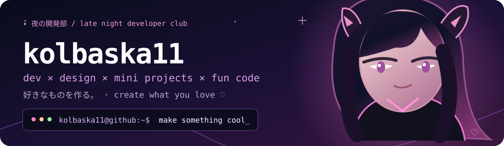
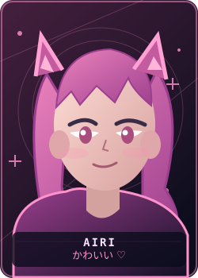
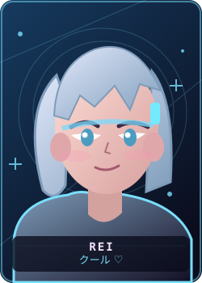
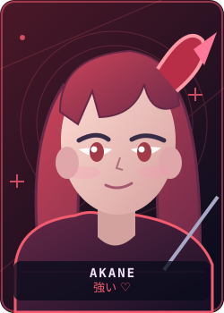
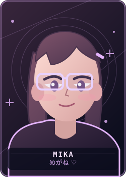
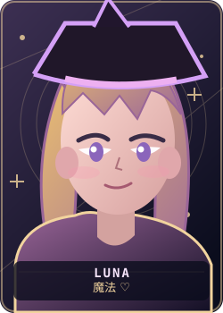
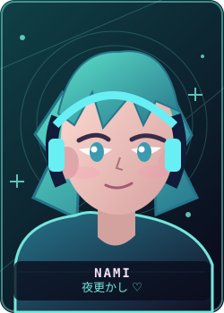
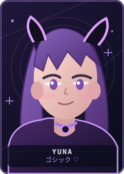
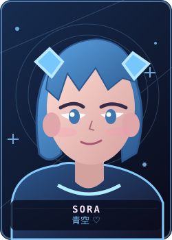

<div align="center">



<br>

<sub>✦ ようこそ、私の小さな世界へ。 · Welcome to my little corner of GitHub ✦</sub>

### <code>dev × design × mini projects × fun code</code>

**Привет! Я `kolbaska11` — пишу код, делаю дизайн и люблю превращать случайные идеи в работающие штуки.**


</div>


### <code>~/about-me</code> <sub>· 私について</sub>

```yaml
username: kolbaska11
role: Developer / Designer
currently: Applied Informatics student
interests: [Python, C#, websites, automation, design, music, anime]
mood: "creating useful stuff, one commit at a time"
```

| 💻 DEV · 開発 | 🎨 DESIGN · デザイン | 🧩 MINI PROJECTS · 小さな作品 | 🎮 FUN CODE · 遊び |
|:--|:--|:--|:--|
| Python, C#, database work and experiments | Print layouts, graphics, interface ideas | Parsers, imports, helpful utilities | Bots, silly scripts and late-night prototypes |
| `code > sleep` | `pixel perfect?` | `ship small things` | `why not?` |

### <code>~/projects</code> <sub>· 作っているもの</sub>

| Project | Description | |
|:--|:--|:--:|
| 🎧 [**Liner Importer — VK & Yandex Music**](https://github.com/kolbaska11/liner-importer-vk-yandex-music) | Перенос плейлистов из VK и Яндекс Музыки через YouTube Music, с подготовкой для Liner | `Python` |
| 🌐 [**SiteAP**](https://github.com/kolbaska11/SiteAP) | Веб-проект и эксперименты с интерфейсами | `Web` |
| 🗃️ [**Databases**](https://github.com/kolbaska11/databases) | Работа с базами данных и учебные задания | `DB` |
| 🐍 [**PythonLabs**](https://github.com/kolbaska11/PythonLabs-2nd-kurs) | Лабораторные и практика на Python | `Python` |
| 🧪 [**Applied Informatics Projects**](https://github.com/kolbaska11/kp-pi-Pelevin) | Учебные проекты по прикладной информатике | `Study` |

<sub>※ Некоторые эксперименты остаются приватными. В списке выше только публичные репозитории.</sub>

### <code>~/anime-corner</code> <sub>· 推しとかわいいもの ♡</sub>

<div align="center">


<table>
<tr>
<td width="25%" align="center"><br/><sub>🌸 Airi · かわいい</sub></td>
<td width="25%" align="center"><br/><sub>❄️ Rei · クール</sub></td>
<td width="25%" align="center"><br/><sub>🔥 Akane · 強い</sub></td>
<td width="25%" align="center"><br/><sub>📚 Mika · めがね</sub></td>
</tr>
<tr>
<td width="25%" align="center"><br/><sub>🌙 Luna · 魔法</sub></td>
<td width="25%" align="center"><br/><sub>🎧 Nami · 夜更かし</sub></td>
<td width="25%" align="center"><br/><sub>🦇 Yuna · ゴシック</sub></td>
<td width="25%" align="center"><br/><sub>💙 Sora · 青空</sub></td>
</tr>
</table>

<sub>Original anime-inspired illustrations · 8 different characters · ♡ かわいいは正義 ♡</sub>
</div>

### <code>~/activity</code> <sub>· 毎日少しずつ</sub>

<div align="center">

[](https://github.com/kolbaska11)

<sub>Small commits, big dreams. · 継続は力なり。</sub>


</div>
