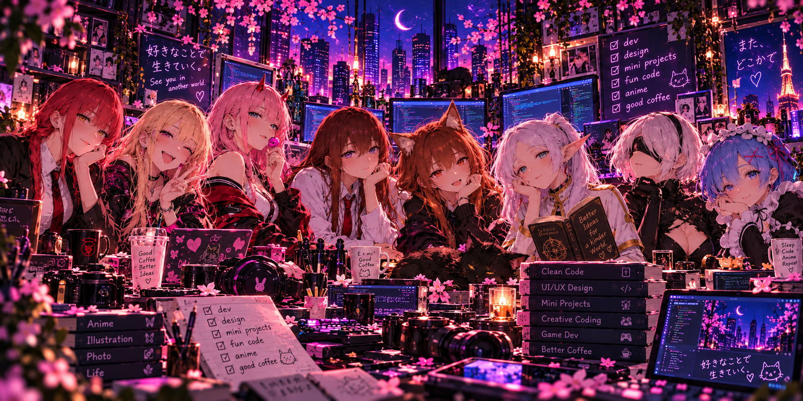
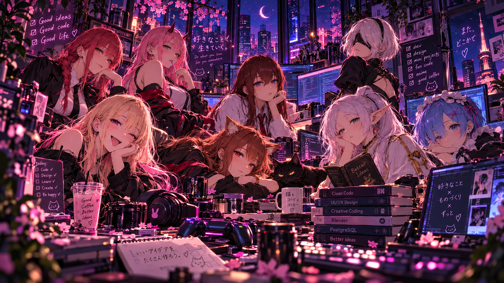
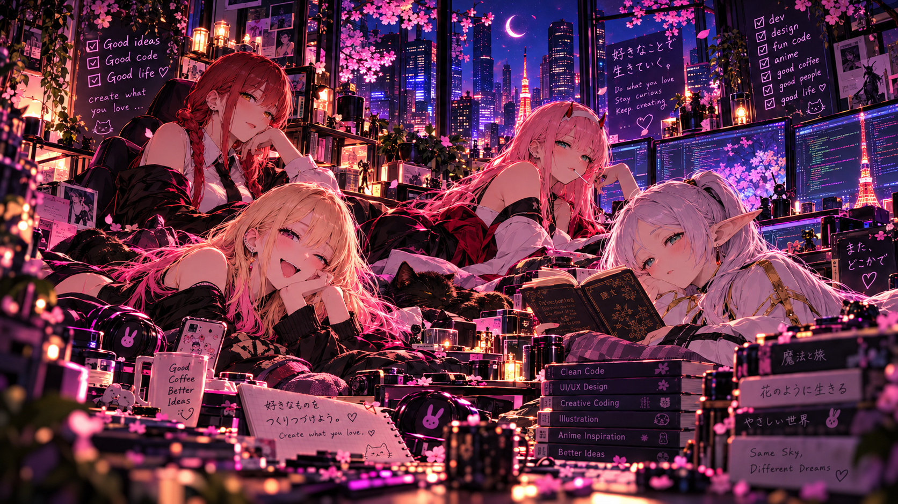

  

# kolbaska11

**dev × design × mini projects × fun code**

*Good code. Good design. Good anime.*

Привет, я **kolbaska11**. Делаю код, дизайн, мини-проекты и просто интересные штуки.  
Люблю музыку, аниме, ночную эстетику и собирать вещи, которыми приятно пользоваться.

 

### About me

**Developer / Designer** · Applied Informatics student

Пишу на **Python и C#**, работаю с **PostgreSQL**, пробую **Web** и создаю дизайн — от полиграфии до интерфейсов. Люблю небольшие полезные инструменты и creative coding.

**Music · Anime · Mini Projects · Creative Coding**

 

  

 

### Projects

- **[liner-importer-vk-yandex-music](https://github.com/kolbaska11/liner-importer-vk-yandex-music)** — перенос списков треков из VK и Яндекс Музыки в YouTube Music с подготовкой для Liner.
- **[SiteAP](https://github.com/kolbaska11/SiteAP)** — публичная интерактивная демонстрация клиентского интерфейса типографии «Арт Проджект».
- **[kp-pi-Pelevin](https://github.com/kolbaska11/kp-pi-Pelevin)** — JobFinder: учебное приложение поиска работы и персонала на Python, Tkinter и SQLite.
- **[PythonLabs-2nd-kurs](https://github.com/kolbaska11/PythonLabs-2nd-kurs)** — практика Python: регулярные выражения, проверка формата дат и обработка исключений.
- **[databases](https://github.com/kolbaska11/databases)** — учебный отчёт по лабораторной работе с базами данных.

**Mini tools** · [MTS → MP4](https://github.com/kolbaska11/mts-to-mp4-converter) · [Фото → A5 PDF](https://github.com/kolbaska11/photos-to-a5-pdf) · [Превью макетов](https://github.com/kolbaska11/print-mockup-preview) · [Удаление фона](https://github.com/kolbaska11/batch-background-remover)

 

  

Create what you love. · See you in the next commit ♡

